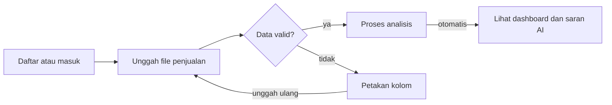
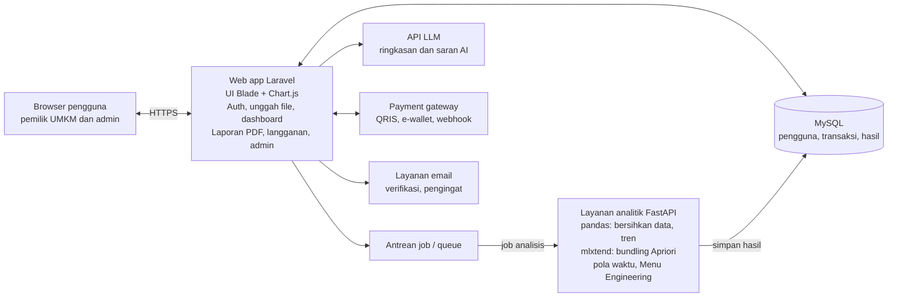

# PRD InsightUsaha — Web App

Versi: 6 November 2026

## 0. Instruksi untuk AI Agent

- Bangun aplikasi web sesuai PRD ini. Kerjakan fitur berurutan mengikuti **Milestone** di bagian 8 (Must dulu, lalu Should).
- Patuhi tech stack di bagian 7 kecuali diminta lain.
- Semua teks antarmuka (UI) dalam **bahasa Indonesia**.
- Setiap fitur dianggap selesai hanya jika semua **acceptance criteria**-nya terpenuhi. Tulis test untuk tiap acceptance criteria jika memungkinkan.
- Setiap query data pengguna **wajib dibatasi per `business_id`** (multi-tenant).
- Jangan pernah mengirim data mentah transaksi ke API LLM; kirim hanya hasil agregat.
- Jika ada hal yang tidak dijelaskan di PRD, pilih solusi paling sederhana dan catat asumsinya.

## 1. Ringkasan Produk

InsightUsaha adalah aplikasi web SaaS yang mengubah data penjualan UMKM kuliner menjadi insight dan saran tindakan dalam bahasa Indonesia. Versi MVP harus selesai dan diuji ke 10 UMKM dalam 4 bulan.

**Masalah.** UMKM sudah punya data penjualan (dari aplikasi kasir atau Excel), tetapi tidak pernah menganalisisnya. Keputusan soal menu, promo, bundling, dan stok masih diambil berdasarkan perasaan, karena pemilik usaha tidak punya waktu maupun keahlian analisis data.

**Solusi.** Pengguna mengunggah file penjualan, lalu sistem otomatis menampilkan dashboard, produk yang naik dan turun, jam ramai, rekomendasi bundling (Apriori), klasifikasi menu (Menu Engineering), dan ringkasan AI.

**Tujuan produk**

| Tujuan | Ukuran | Target |
| --- | --- | --- |
| Fitur inti selesai | Fitur MVP lolos acceptance criteria | 6 fitur |
| Mudah dipakai | Skor System Usability Scale (SUS) | ≥ 68 |
| Cepat memberi insight | Waktu dari unggah file sampai dashboard tampil | < 60 detik untuk 50.000 baris |
| Diterima pasar | UMKM uji coba / pengguna terdaftar / pelanggan berbayar | 10 / 30 / 5 |

## 2. Pengguna dan User Stories

Pengguna utama adalah pemilik UMKM kuliner mikro-kecil di Surabaya yang mencatat penjualan secara digital tetapi tidak punya keahlian analisis data.

| Persona | Profil | Kebutuhan utama |
| --- | --- | --- |
| Rina, pemilik kedai kopi | 28 tahun, 1 outlet, ±120 transaksi/hari, pakai aplikasi kasir, sering buka HP | Tahu menu mana yang untung, kapan pasang promo, ide paket bundling |
| Pak Budi, pemilik warung makan | 45 tahun, catat penjualan di Excel, kurang paham teknologi | Ringkasan sederhana tanpa grafik rumit, panduan unggah data |
| Admin sistem (tim InsightUsaha) | Anggota tim yang mengelola platform | Kelola pengguna, paket langganan, pantau error dan penggunaan |

**User stories (prioritas MoSCoW)**

| ID | Sebagai | Saya ingin | Supaya | Prioritas |
| --- | --- | --- | --- | --- |
| US-01 | Pemilik UMKM | daftar dan masuk dengan email | data usaha saya aman di akun sendiri | Must |
| US-02 | Pemilik UMKM | mengunggah file penjualan Excel/CSV | tidak perlu input ulang data | Must |
| US-03 | Pemilik UMKM | mengunduh template file | tahu format data yang benar | Must |
| US-04 | Pemilik UMKM | melihat omzet, transaksi, dan tren penjualan | tahu kondisi usaha sekilas | Must |
| US-05 | Pemilik UMKM | melihat produk yang naik dan turun | tahu produk mana yang perlu perhatian | Must |
| US-06 | Pemilik UMKM | melihat jam dan hari ramai/sepi | bisa menjadwalkan promo dan karyawan | Must |
| US-07 | Pemilik UMKM | mendapat rekomendasi paket bundling | bisa menaikkan nilai transaksi | Must |
| US-08 | Pemilik UMKM | membaca ringkasan dan saran AI | langsung tahu apa yang harus dilakukan | Must |
| US-09 | Pemilik UMKM | mengisi HPP dan melihat klasifikasi menu | tahu menu yang harus dipertahankan atau dihapus | Should |
| US-10 | Pemilik UMKM | mengunduh laporan PDF | bisa menyimpan atau membagikannya | Should |
| US-11 | Pemilik UMKM | berlangganan paket Pro dengan QRIS/e-wallet | membuka semua fitur | Should |
| US-12 | Admin | melihat daftar pengguna dan status langganan | bisa mengelola layanan | Should |
| US-13 | Pemilik UMKM | menerima ringkasan mingguan via email/WhatsApp | tidak perlu membuka aplikasi | Could |

## 3. Ruang Lingkup

MVP mencakup semua fitur prioritas Must dan Should (US-01 sampai US-12). Fitur Could dan integrasi otomatis dikerjakan setelah uji coba.

**Masuk MVP**

- Autentikasi (daftar, masuk, lupa kata sandi) dan profil usaha
- Unggah file Excel/CSV, template, validasi, dan pemetaan kolom
- Dashboard penjualan, produk naik/turun, pola waktu ramai
- Rekomendasi bundling (Apriori) dan klasifikasi menu (Menu Engineering)
- Ringkasan dan saran AI berbahasa Indonesia
- Laporan PDF, paket langganan Gratis/Pro, pembayaran via payment gateway
- Panel admin sederhana

**Di luar MVP (jangan dikerjakan dulu)**

- Integrasi API langsung dengan aplikasi kasir (data tetap lewat unggah file)
- Ringkasan otomatis via WhatsApp (US-13)
- Prediksi penjualan dan stok dengan machine learning
- Multi-outlet (paket Bisnis) dan akun institusi
- Aplikasi mobile native (MVP cukup web responsif)

## 4. Kebutuhan Fungsional

Setiap fitur dianggap selesai jika semua acceptance criteria-nya lolos black box testing.

### F1. Autentikasi dan Profil Usaha (US-01)

- Daftar dengan nama, email, kata sandi (min. 8 karakter), nama usaha, dan jenis usaha.
- Verifikasi email, masuk, keluar, dan reset kata sandi lewat email.
- Profil usaha: nama, kota, jenis usaha, jam buka.

Acceptance criteria:

- [ ] Email yang sudah terdaftar ditolak dengan pesan jelas.
- [ ] Pengguna yang belum masuk diarahkan ke halaman login saat membuka dashboard.
- [ ] Data satu pengguna tidak bisa diakses pengguna lain.

### F2. Unggah dan Validasi Data (US-02, US-03)

- Menerima file .xlsx dan .csv, maksimal 10 MB atau 50.000 baris.
- Menyediakan template unduhan (lihat bagian 7 untuk kolomnya).
- Pemetaan kolom: jika nama kolom berbeda dari template, pengguna memilih kolom mana yang berisi tanggal, produk, jumlah, dan harga.
- Membersihkan data: hapus baris kosong dan duplikat, menyamakan penulisan nama produk (huruf besar/kecil, spasi).
- Menampilkan ringkasan hasil impor: jumlah baris valid, baris ditolak beserta alasannya, dan rentang tanggal data.

Acceptance criteria:

- [ ] File selain .xlsx/.csv ditolak sebelum diunggah.
- [ ] Baris dengan tanggal atau jumlah tidak valid dilewati dan dilaporkan, bukan membuat seluruh impor gagal.
- [ ] Unggahan data pada rentang tanggal yang sama menanyakan: ganti data lama atau gabungkan.

### F3. Dashboard Penjualan (US-04)

- Kartu ringkasan: total omzet, jumlah transaksi, rata-rata nilai transaksi, produk terlaris, beserta perubahan (%) dibanding periode sebelumnya.
- Grafik tren omzet harian/mingguan/bulanan.
- Filter periode: 7 hari, 30 hari, 3 bulan, rentang kustom.

Acceptance criteria:

- [ ] Angka di dashboard sama dengan perhitungan manual Excel pada dataset uji.
- [ ] Dashboard tampil < 3 detik setelah data selesai diproses.

### F4. Produk Naik dan Turun (US-05)

- Tabel produk dengan penjualan periode ini, periode sebelumnya, dan perubahan (%).
- Label otomatis: Naik (> +10%), Stabil, Turun (< −10%), serta Produk Baru.
- Produk dengan penjualan terlalu sedikit (< 5 unit di kedua periode) tidak diberi label agar tidak menyesatkan.

Acceptance criteria:

- [ ] Persentase perubahan sesuai rumus (periode ini − periode lalu) / periode lalu × 100%.

### F5. Pola Waktu Ramai (US-06)

- Heatmap hari (Senin–Minggu) × jam berdasarkan jumlah transaksi.
- Menyebut 3 slot tersibuk dan 3 slot tersepi.
- Jika data tidak punya kolom jam, hanya ditampilkan pola per hari.

Acceptance criteria:

- [ ] Heatmap tetap tampil (versi per hari) untuk data tanpa jam.

### F6. Rekomendasi Bundling (US-07)

- Algoritma Apriori pada data per transaksi (wajib ada kolom ID transaksi).
- Menampilkan pasangan produk dengan support, confidence, dan lift, diurutkan berdasarkan lift.
- Default: minimum support 1%, minimum confidence 30%, hanya aturan dengan lift > 1. Nilai bisa diubah pengguna di pengaturan lanjutan.
- Setiap aturan ditulis ulang dalam kalimat, misalnya "45% pembeli Croissant juga membeli Kopi Susu".

Acceptance criteria:

- [ ] Jika data tidak punya ID transaksi, fitur menampilkan pesan penjelasan, bukan error.
- [ ] Hasil sama dengan perhitungan pustaka mlxtend pada dataset uji.

### F7. Klasifikasi Menu (US-09)

- Pengguna mengisi HPP per produk (manual atau unggah file).
- Sistem menghitung popularitas (porsi penjualan) dan margin kontribusi per produk.
- Klasifikasi Menu Engineering: Star (populer, margin tinggi), Plowhorse (populer, margin rendah), Puzzle (kurang populer, margin tinggi), Dog (kurang populer, margin rendah).
- Batas popularitas = 70% × (1 / jumlah menu); batas margin = rata-rata margin tertimbang.
- Ditampilkan sebagai diagram 4 kuadran beserta saran per kategori.

Acceptance criteria:

- [ ] Produk tanpa HPP ditandai "belum lengkap" dan tidak diklasifikasikan.

### F8. Ringkasan dan Saran AI (US-08)

- Sistem mengirim **hasil agregat** (bukan data mentah transaksi) ke API LLM.
- Keluaran: 3–5 temuan utama dan 3 saran tindakan, maksimal ±150 kata, bahasa Indonesia santai.
- Setiap angka dalam ringkasan harus berasal dari hasil analisis; prompt melarang model mengarang angka.
- Ringkasan disimpan per periode sehingga tidak dibuat ulang setiap halaman dibuka.
- Ada tombol "Membantu / Tidak membantu" untuk mengukur kualitas.

Acceptance criteria:

- [ ] Jika API AI gagal, dashboard tetap tampil dengan pesan "ringkasan belum tersedia".
- [ ] Pada 20 sampel uji, tidak ada angka di ringkasan yang berbeda dari hasil analisis.

### F9. Laporan PDF (US-10)

- Unduh laporan berisi kartu ringkasan, grafik tren, produk naik/turun, bundling, dan ringkasan AI untuk periode yang dipilih.

### F10. Langganan dan Pembayaran (US-11)

| Paket | Harga | Batasan |
| --- | --- | --- |
| Gratis | Rp0 | 1 unggahan/bulan, data 3 bulan, hanya F3 dan F4 |
| Pro | Rp49.000/bulan | Semua fitur F2–F9, unggahan tanpa batas |

- Pembayaran via payment gateway (QRIS, e-wallet, virtual account); status langganan diperbarui otomatis lewat webhook.
- Pengingat perpanjangan H-3 via email; jika tidak diperpanjang, akun turun ke paket Gratis tanpa menghapus data.

### F11. Panel Admin (US-12)

- Daftar pengguna, paket, tanggal berakhir langganan, jumlah unggahan.
- Statistik: pengguna aktif, pelanggan berbayar, pendapatan bulan ini.
- Log error impor dan kegagalan API AI.

## 5. Kebutuhan Nonfungsional

| Aspek | Kebutuhan |
| --- | --- |
| Kinerja | Halaman dimuat < 3 detik; file 50.000 baris selesai diproses < 60 detik (diproses di latar belakang dengan indikator progres) |
| Kapasitas | Melayani ±200 pengguna aktif pada tahap awal di 1 VPS |
| Keamanan | HTTPS, kata sandi di-hash (bcrypt), proteksi CSRF, batas percobaan login, setiap query dibatasi per `business_id` |
| Privasi data | Hanya data agregat yang dikirim ke API AI; kebijakan privasi mengacu UU No. 27/2022 tentang Pelindungan Data Pribadi; pengguna bisa menghapus akun beserta datanya |
| Ketersediaan | Target uptime 99% selama jam operasional; backup basis data harian, disimpan 7 hari |
| Kegunaan | Responsif di HP (lebar layar 360 px ke atas); seluruh antarmuka berbahasa Indonesia; skor SUS ≥ 68 |
| Kompatibilitas | Chrome, Edge, dan Safari versi terbaru |
| Pemeliharaan | Kode di GitHub dengan code review; log error terpusat |

## 6. Alur Pengguna dan Halaman

Alur utama MVP: pengguna baru harus sampai ke dashboard berisi saran AI dalam satu sesi, tanpa bantuan.



Jika data tidak valid, pengguna diarahkan ke pemetaan kolom lalu mengunggah ulang; setelah dashboard tampil, pengguna bisa mengunduh PDF atau mengunggah data periode berikutnya.

**Daftar halaman (sitemap)**

| Halaman | URL | Isi utama | Akses |
| --- | --- | --- | --- |
| Landing page | / | Penjelasan produk, contoh insight, harga, tombol daftar | Publik |
| Daftar / Masuk / Lupa sandi | /register, /login, /forgot | Form autentikasi | Publik |
| Onboarding | /onboarding | Isi profil usaha, unduh template, unggah file pertama | Pengguna |
| Dashboard | /dashboard | Kartu ringkasan, grafik tren, ringkasan AI | Pengguna |
| Produk | /produk | Produk naik/turun, isi HPP | Pengguna |
| Pola waktu | /waktu | Heatmap hari × jam | Pengguna |
| Bundling | /bundling | Daftar pasangan produk + kalimat saran | Pro |
| Klasifikasi menu | /menu | Diagram 4 kuadran + saran per kategori | Pro |
| Data | /data | Riwayat unggahan, unggah baru, pemetaan kolom, hapus data | Pengguna |
| Laporan | /laporan | Pilih periode, unduh PDF | Pro |
| Langganan | /langganan | Paket aktif, upgrade, riwayat pembayaran | Pengguna |
| Pengaturan | /pengaturan | Profil, kata sandi, hapus akun | Pengguna |
| Admin | /admin | Pengguna, langganan, statistik, log error | Admin |

## 7. Data, Arsitektur, dan Tech Stack

Web app Laravel menangani pengguna, sedangkan analisis berat dijalankan layanan Python terpisah lewat antrean job supaya halaman tidak macet saat file besar diproses.



Web app menyimpan file dan membuat job; layanan analitik mengambil job, menulis hasil ke MySQL, lalu web app memanggil API LLM untuk ringkasan dari hasil agregat tersebut.

**Format file unggah (template)**

| Kolom | Format | Wajib | Dipakai untuk |
| --- | --- | --- | --- |
| tanggal | YYYY-MM-DD | Ya | Semua analisis |
| jam | HH:MM | Tidak | F5 pola jam |
| id_transaksi | Teks/angka | Tidak | F6 bundling |
| nama_produk | Teks | Ya | Semua analisis produk |
| kategori | Teks | Tidak | Filter dashboard |
| jumlah | Angka bulat | Ya | Penjualan unit |
| harga_satuan | Angka (Rp) | Ya | Omzet, margin |

```csv
tanggal,jam,id_transaksi,nama_produk,kategori,jumlah,harga_satuan
2026-10-01,08:15,TRX001,Kopi Susu Gula Aren,Minuman,2,18000
2026-10-01,08:15,TRX001,Croissant,Makanan,1,22000
2026-10-01,09:40,TRX002,Americano,Minuman,1,15000
```

**Model data (entitas utama)**

| Entitas | Atribut utama | Relasi |
| --- | --- | --- |
| users | id, nama, email, password_hash, role (owner/admin) | 1 user punya 1 business |
| businesses | id, user_id, nama_usaha, kota, jenis_usaha | punya banyak uploads, products, transactions |
| uploads | id, business_id, nama_file, jumlah_baris_valid, jumlah_baris_ditolak, status, dibuat_pada | punya banyak transactions |
| products | id, business_id, nama, kategori, hpp | dirujuk transaction_items |
| transactions | id, business_id, upload_id, kode_transaksi, waktu | punya banyak transaction_items |
| transaction_items | id, transaction_id, product_id, jumlah, harga_satuan | — |
| analysis_results | id, business_id, jenis (tren/waktu/bundling/menu), periode_mulai, periode_selesai, hasil_json | dibuat per job analisis |
| ai_summaries | id, business_id, periode, isi, umpan_balik | merujuk analysis_results periode yang sama |
| subscriptions | id, business_id, paket, mulai, berakhir, status | punya banyak payments |
| payments | id, subscription_id, jumlah, metode, status, ref_gateway | — |

**Tech stack**

| Lapisan | Pilihan | Alasan |
| --- | --- | --- |
| Web app | Laravel (PHP) + Blade + Tailwind CSS | Umum diajarkan, autentikasi dan queue sudah tersedia |
| Grafik | Chart.js | Ringan, cukup untuk line, bar, heatmap |
| Analitik | Python FastAPI + pandas + mlxtend | Apriori siap pakai, mudah diuji terhadap Excel |
| Basis data | MySQL | Relasional, familiar bagi tim |
| Antrean | Laravel Queue (driver database/Redis) | Proses file besar di latar belakang |
| AI | API LLM (penyedia ditentukan) | Ringkasan bahasa Indonesia |
| Pembayaran | Payment gateway lokal (QRIS, e-wallet) | Webhook status pembayaran |
| Hosting | VPS + Nginx + SSL Let's Encrypt | Murah, sesuai anggaran Rp350.000/bulan |

## 8. Metrik, Milestone, Risiko, dan Pertanyaan Terbuka

**Metrik keberhasilan**

| Metrik | Target akhir program | Sumber data |
| --- | --- | --- |
| Aktivasi: pengguna yang berhasil unggah data pertama | ≥ 70% dari pendaftar | Tabel `uploads` |
| Pengguna aktif mingguan | ≥ 15 | Log aktivitas |
| Ringkasan AI dinilai "membantu" | ≥ 70% | Tombol umpan balik F8 |
| Skor SUS | ≥ 68 | Kuesioner uji coba |
| Pelanggan berbayar | ≥ 5 | Payment gateway |

**Milestone (sprint 2 minggu, 4 bulan)**

1. Sprint 1 (minggu 1–2): analisis kebutuhan, wireframe, ERD, setup repositori dan server.
2. Sprint 2 (minggu 3–4): F1 autentikasi, F2 unggah dan validasi data.
3. Sprint 3 (minggu 5–6): F3 dashboard, F4 produk naik/turun.
4. Sprint 4 (minggu 7–8): F5 pola waktu, F6 bundling Apriori.
5. Sprint 5 (minggu 9–10): F7 klasifikasi menu, F8 ringkasan AI.
6. Sprint 6 (minggu 11–12): F9 PDF, F10 pembayaran, F11 admin, deploy.
7. Sprint 7 (minggu 13–14): black box testing, uji coba ke 10 UMKM, uji SUS.
8. Sprint 8 (minggu 15–16): perbaikan dari hasil uji, peluncuran, evaluasi.

**Risiko dan mitigasi**

| Risiko | Dampak | Mitigasi |
| --- | --- | --- |
| Format data UMKM sangat beragam dan berantakan | Impor gagal, pengguna menyerah | Template, pemetaan kolom, pesan error yang jelas, pendampingan saat unggah pertama |
| Data tanpa ID transaksi atau jam | F5 dan F6 tidak bisa jalan | Tampilkan versi terbatas dengan penjelasan; dorong ekspor dari aplikasi kasir |
| AI mengarang angka atau saran tidak masuk akal | Pengguna tidak percaya | Kirim hanya hasil agregat, larang angka baru di prompt, uji 20 sampel, tombol umpan balik |
| Biaya API AI membengkak | Margin habis | Ringkasan disimpan per periode, batasi jumlah generate per bulan |
| UMKM enggan membagikan data penjualan | Adopsi rendah | Kebijakan privasi jelas, tidak ada data mentah ke pihak ketiga, opsi hapus data |
| Waktu pengembangan tidak cukup | Fitur tidak selesai | Kerjakan Must dulu; F7, F9, F10 bisa dipangkas |

**Pertanyaan terbuka**

- [ ] Aplikasi kasir apa yang paling banyak dipakai UMKM uji coba? Template impor khusus dibuat untuk itu.
- [ ] Harga Rp49.000 sudah tervalidasi lewat survei, atau perlu diuji dengan dua pilihan harga?
- [ ] Penyedia LLM dan payment gateway mana yang dipakai (biaya dan kemudahan integrasi)?
- [ ] Apakah klasifikasi menu (F7) tetap masuk MVP mengingat pengguna harus mengisi HPP?
